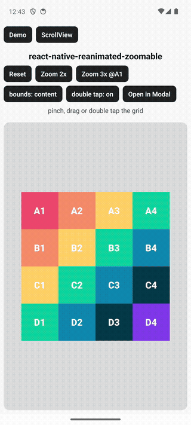
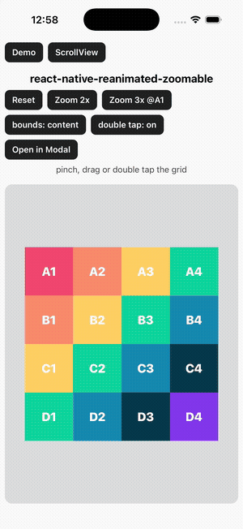

# react-native-reanimated-zoomable

Pinch-to-zoom, pan and double-tap-to-zoom for **any** React Native view.

- Runs entirely on the UI thread (Reanimated worklets + Gesture Handler) – no JS work per frame
- Correct focal-point pinch, two-finger pan, fling momentum, rubber-band edges
- Optional photo-viewer bounds (`panBoundary="content"`), double tap, `ScrollView`/pager friendly mode
- Works inside `<Modal>` on Android without extra setup
- New Architecture (Fabric), React 19, Reanimated 4 (and 3), Gesture Handler 3 (and 2), Expo
- TypeScript, ESM + CommonJS, zero dependencies

| Android | iOS |
| :-: | :-: |
|  |  |

## Installation

```sh
npm install react-native-reanimated-zoomable
# peer dependencies
npx expo install react-native-reanimated react-native-gesture-handler   # Expo
npm install react-native-reanimated react-native-gesture-handler        # bare React Native
```

Follow the Reanimated and Gesture Handler installation guides (Babel plugin for Reanimated 3,
`react-native-worklets` for Reanimated 4) and wrap your app in `GestureHandlerRootView`.

| Peer | Supported |
| --- | --- |
| `react-native` | ≥ 0.76 |
| `react-native-reanimated` | ≥ 3.16 (incl. 4.x with `react-native-worklets`) |
| `react-native-gesture-handler` | ≥ 2.20 (incl. 3.x) |

Verified on Android 14 and iOS 26 with Expo SDK 58 (React Native 0.88, New Architecture,
Reanimated 4.7, Gesture Handler 3.3); type-checked against Reanimated 3.16 / Gesture Handler 2.20 /
React 18.

## Usage

```tsx
import { useRef } from 'react';
import { Button, Image, View } from 'react-native';
import { Zoomable, type ZoomableRef } from 'react-native-reanimated-zoomable';

export function Photo() {
  const zoomable = useRef<ZoomableRef>(null);

  return (
    <View style={{ flex: 1, overflow: 'hidden' }}>
      <Zoomable
        ref={zoomable}
        style={{ flex: 1, justifyContent: 'center', alignItems: 'center' }}
        maxScale={4}
        panBoundary="content"
        doubleTapToZoom
      >
        <Image
          source={{ uri: 'https://picsum.photos/id/2/1000/1000' }}
          style={{ width: 360, height: 360 }}
        />
      </Zoomable>
      <Button title="Reset" onPress={() => zoomable.current?.reset()} />
    </View>
  );
}
```

> The zoomed content is not clipped by the component; wrap it in a view with
> `overflow: 'hidden'` if it must stay inside a frame.

## Props

| Prop | Type | Default | Description |
| --- | --- | --- | --- |
| `style` | `ViewStyle` | – | Layout props (size, flex, margin, position, transform, opacity) stay on the container; the rest (background, padding, child alignment…) applies to the zoomed content. |
| `initialScale` | `number` | `1` | Scale on mount and after `reset()`. |
| `minScale` | `number` | `initialScale` | Smallest pinch scale. |
| `maxScale` | `number` | `initialScale * 2` | Largest pinch scale. Pinching past a limit rubber-bands and springs back. |
| `panBoundary` | `'threshold' \| 'content' \| 'none'` | `'threshold'` | `threshold`: up to `threshold * scale / minScale` points (classic behavior). `content`: never reveal empty space inside the container edges. `none`: unlimited. |
| `threshold` | `number` | `300` | Max translation (points, at `minScale`) for `panBoundary="threshold"`. |
| `shouldCenterAfterThreshold` | `boolean` | `false` | Released past the boundary → animate back to the center instead of to the boundary. |
| `disableOvershooting` | `boolean` | `false` | No momentum after a fling. |
| `disablePanResponderReleaseAction` | `boolean` | `false` | Skip all release animations (boundary snap-back, momentum). The scale is still kept within its limits. |
| `doubleTapToZoom` | `boolean` | `false` | Double tap zooms to `doubleTapScale` at the tapped point, or back to `initialScale`. |
| `doubleTapScale` | `number` | `maxScale` | Target scale of a double tap. |
| `panRequiresZoom` | `boolean` | `false` | One-finger pan only while zoomed in, so a parent `ScrollView`/pager keeps scrolling. |
| `disabled` | `boolean` | `false` | Disable all gestures. |
| `onInteractionStart` | `() => void` | – | Called (JS thread) when a gesture starts. |
| `onInteractionEnd` | `(t: { scale, translate: { x, y } }) => void` | – | Called (JS thread) when a gesture ends, with the transform it settles to. |
| `testID` | `string` | – | |

### Ref

```ts
interface ZoomableRef {
  setValues(v: { scale?: number; translate?: { x: number; y: number } }): void; // immediate
  zoomTo(scale: number, opts?: { focal?: { x: number; y: number }; animated?: boolean }): void;
  reset(opts?: { animated?: boolean }): void;
  getValues(): { scale: number; translate: { x: number; y: number } };
}
```

All values are clamped to the scale limits and the pan boundary. `focal` is relative to the
top-left corner of the component.

## Migrating from 0.x

1.0 is a rewrite on Gesture Handler (0.x used `PanResponder` on the JS thread).

1. `react-native-reanimated` is now a **peer** dependency (it used to be a regular dependency,
   which caused “multiple versions of Reanimated” errors) and `react-native-gesture-handler` is a
   new peer dependency. Install both and wrap your app in `GestureHandlerRootView`.
2. All 0.x props and `ref.setValues()` keep working. Behavior changes:
   - a pinch keeps the point under your fingers fixed, and a two-finger drag pans;
   - the 0.x “overshooting” drift (10 % further over 1 s) is replaced by real fling momentum;
   - after a pinch the content is brought back inside the boundary;
   - a `transform` in `style` no longer disables zooming (it now transforms the container).
3. New: `minScale`, `panBoundary`, `doubleTapToZoom`, `doubleTapScale`, `panRequiresZoom`,
   `onInteractionStart`/`onInteractionEnd`, `ref.zoomTo()`/`reset()`/`getValues()`.

## Example app

```sh
yarn
yarn example start   # press a / i, or open it in Expo Go (SDK 58)
```

It covers all gestures, the three boundary modes, a React Native `<Modal>` and a `ScrollView`.
Screenshots from emulator runs are in [`docs/screenshots`](./docs/screenshots).

## License

MIT
